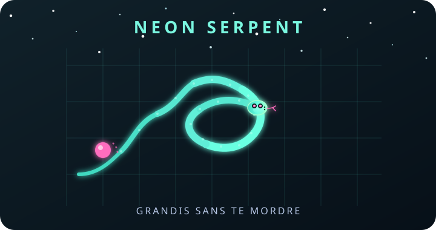
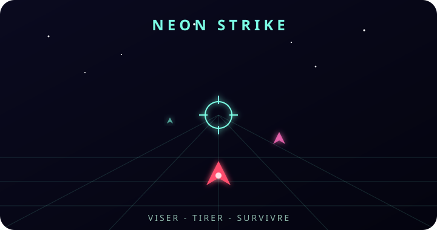

# Neon Games

Une collection de neuf mini-jeux indépendants, gratuits et jouables directement dans le navigateur.

## Ouvrir Neon Games

[Ouvrir Neon Games](https://kewinmarchand.github.io/neon-games/)

## Les jeux

### Neon Invaders

[Ouvrir le jeu](https://kewinmarchand.github.io/neon-games/apps/invaders/) · [Code source](https://github.com/kewinMarchand/neon-games/tree/main/apps/invaders) — Défendez votre base contre des vagues d'envahisseurs.

### Neon Breaker

[Ouvrir le jeu](https://kewinmarchand.github.io/neon-games/apps/breaker/) · [Code source](https://github.com/kewinMarchand/neon-games/tree/main/apps/breaker) — Cassez les briques et gardez la balle en jeu.

### Neon Columns

[Ouvrir le jeu](https://kewinmarchand.github.io/neon-games/apps/columns/) · [Code source](https://github.com/kewinMarchand/neon-games/tree/main/apps/columns) — Alignez des gemmes pour déclencher des réactions en chaîne.

### Neon Drift

[Ouvrir le jeu](https://kewinmarchand.github.io/neon-games/apps/drift/) · [Code source](https://github.com/kewinMarchand/neon-games/tree/main/apps/drift) — Pilotez une voiture sur le circuit, évitez les obstacles et récoltez les orbes.

### Neon Runner

[Ouvrir le jeu](https://kewinmarchand.github.io/neon-games/apps/runner/) · [Code source](https://github.com/kewinMarchand/neon-games/tree/main/apps/runner) — Sautez et glissez pour éviter les obstacles.

### Neon Defender

[Ouvrir le jeu](https://kewinmarchand.github.io/neon-games/apps/defender/) · [Code source](https://github.com/kewinMarchand/neon-games/tree/main/apps/defender) — Orientez le bouclier pour intercepter les photons.

### Neon Mines

[Ouvrir le jeu](https://kewinmarchand.github.io/neon-games/apps/mines/) · [Code source](https://github.com/kewinMarchand/neon-games/tree/main/apps/mines) — Déduisez l'emplacement des mines à partir des indices.

### Neon Serpent

[Ouvrir le jeu](https://kewinmarchand.github.io/neon-games/apps/serpent/) · [Code source](https://github.com/kewinMarchand/neon-games/tree/main/apps/serpent) — Grandissez sans vous mordre, la vitesse s'emballe.

### Neon Orbiter

[Ouvrir le jeu](https://kewinmarchand.github.io/neon-games/apps/orbiter/) · [Code source](https://github.com/kewinMarchand/neon-games/tree/main/apps/orbiter) — Alunissez en douceur : gravité, carburant et plates-formes bonus.

### Neon Maze

[Ouvrir le jeu](https://kewinmarchand.github.io/neon-games/apps/maze/) . [Code source](https://github.com/kewinMarchand/neon-games/tree/main/apps/maze) - Mangez les pastilles, echappez aux fantomes, passez au niveau suivant.

### Neon Pong

[Ouvrir le jeu](https://kewinmarchand.github.io/neon-games/apps/pong/) . [Code source](https://github.com/kewinMarchand/neon-games/tree/main/apps/pong) - Renvoyez la balle, marquez des points, premier a 11.

### Neon Strike

[Ouvrir le jeu](https://kewinmarchand.github.io/neon-games/apps/strike/) . [Code source](https://github.com/kewinMarchand/neon-games/tree/main/apps/strike) - Abattez les vaisseaux avant qu'ils ne vous atteignent.

## Thème

Ce portail et les jeux utilisent une base CSS partagée (`neon/neon-tokens.css`, `neon-base.css`, `neon-components.css`).

Ce dépôt (monorepo `neon-games`) regroupe le portail et les jeux de la collection.
