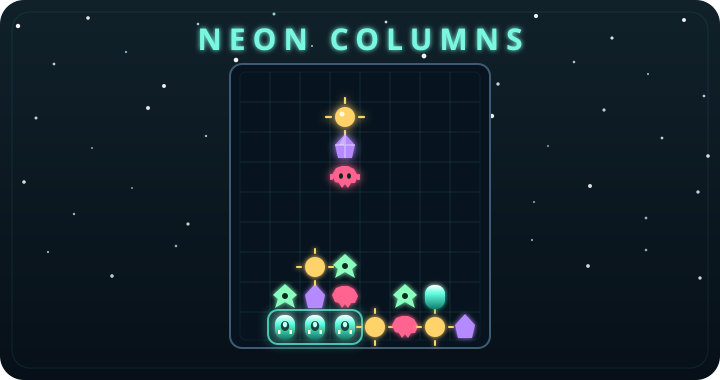
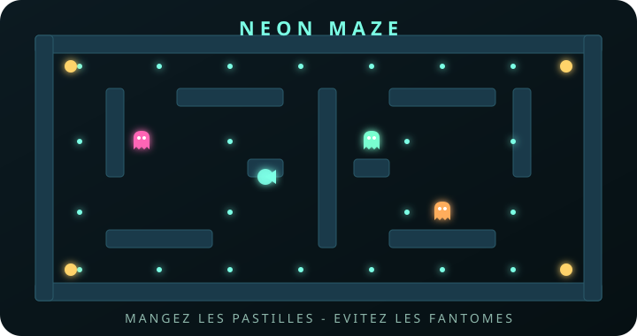
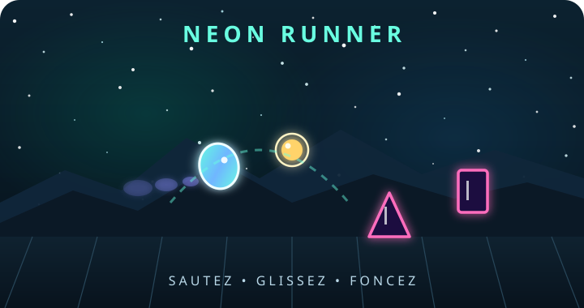
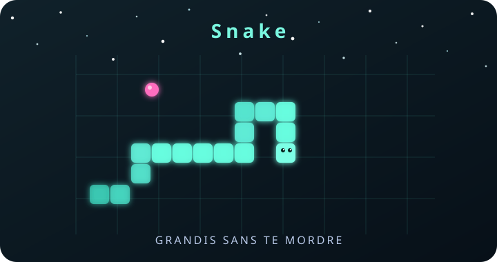

# Arcade Collection

Monorepo des jeux d'arcade pour la pause café.

Une collection de quinze mini-jeux indépendants, jouables directement dans le navigateur.

## Ouvrir Arcade Collection

- [Jouer en ligne](https://kewinmarchand.github.io/arcade-collection/)
- [Code source](https://github.com/kewinMarchand/arcade-collection)

## Les jeux

| | | |
| --- | --- | --- |
|  <strong>Black Holes</strong> Explorez les secteurs spatiaux et repérez les trous noirs grâce aux satellites. <a href="https://kewinmarchand.github.io/arcade-collection/apps/mines/">Jouer</a> · <a href="https://github.com/kewinMarchand/arcade-collection/tree/main/apps/mines">Code source</a> |  <strong>Breaker</strong> Cassez les briques et gardez la balle en jeu. <a href="https://kewinmarchand.github.io/arcade-collection/apps/breaker/">Jouer</a> · <a href="https://github.com/kewinMarchand/arcade-collection/tree/main/apps/breaker">Code source</a> |  <strong>Breach *(Bêta)*</strong> Infiltrez le secteur en vue subjective et éliminez les aliens. <a href="https://kewinmarchand.github.io/arcade-collection/apps/breach/">Jouer</a> · <a href="https://github.com/kewinMarchand/arcade-collection/tree/main/apps/breach">Code source</a> |
|  <strong>Columns</strong> Alignez des symboles pour déclencher des réactions en chaîne. <a href="https://kewinmarchand.github.io/arcade-collection/apps/columns/">Jouer</a> · <a href="https://github.com/kewinMarchand/arcade-collection/tree/main/apps/columns">Code source</a> |  <strong>Defender</strong> Orientez le bouclier pour intercepter les photons. <a href="https://kewinmarchand.github.io/arcade-collection/apps/defender/">Jouer</a> · <a href="https://github.com/kewinMarchand/arcade-collection/tree/main/apps/defender">Code source</a> |  <strong>Drift</strong> Pilotez votre voiture sur le circuit, évitez les obstacles et récoltez les orbes. <a href="https://kewinmarchand.github.io/arcade-collection/apps/drift/">Jouer</a> · <a href="https://github.com/kewinMarchand/arcade-collection/tree/main/apps/drift">Code source</a> |
|  <strong>Invaders</strong> Défendez votre base contre des vagues d'envahisseurs. <a href="https://kewinmarchand.github.io/arcade-collection/apps/invaders/">Jouer</a> · <a href="https://github.com/kewinMarchand/arcade-collection/tree/main/apps/invaders">Code source</a> |  <strong>Jumper</strong> Sautez de plateforme en plateforme, collectez les noyaux et atteignez le portail. <a href="https://kewinmarchand.github.io/arcade-collection/apps/jumper/">Jouer</a> · <a href="https://github.com/kewinMarchand/arcade-collection/tree/main/apps/jumper">Code source</a> |  <strong>Maze</strong> Mangez les pastilles, échappez aux fantômes, passez au niveau suivant. <a href="https://kewinmarchand.github.io/arcade-collection/apps/maze/">Jouer</a> · <a href="https://github.com/kewinMarchand/arcade-collection/tree/main/apps/maze">Code source</a> |
|  <strong>Orbiter</strong> Alunissez en douceur : gravité, carburant et plateformes bonus. <a href="https://kewinmarchand.github.io/arcade-collection/apps/orbiter/">Jouer</a> · <a href="https://github.com/kewinMarchand/arcade-collection/tree/main/apps/orbiter">Code source</a> |  <strong>Pong</strong> Renvoyez la balle, marquez des points, premier à 11. <a href="https://kewinmarchand.github.io/arcade-collection/apps/pong/">Jouer</a> · <a href="https://github.com/kewinMarchand/arcade-collection/tree/main/apps/pong">Code source</a> |  <strong>Runner *(Bêta)*</strong> Sautez et glissez pour éviter les obstacles et tenir la distance. <a href="https://kewinmarchand.github.io/arcade-collection/apps/runner/">Jouer</a> · <a href="https://github.com/kewinMarchand/arcade-collection/tree/main/apps/runner">Code source</a> |
|  <strong>Snake</strong> Grandissez sans vous mordre, la vitesse s'emballe. <a href="https://kewinmarchand.github.io/arcade-collection/apps/snake/">Jouer</a> · <a href="https://github.com/kewinMarchand/arcade-collection/tree/main/apps/snake">Code source</a> |  <strong>Sorter *(Bêta)*</strong> Triez les symboles identiques et expédiez les palettes avant saturation. <a href="https://kewinmarchand.github.io/arcade-collection/apps/sorter/">Jouer</a> · <a href="https://github.com/kewinMarchand/arcade-collection/tree/main/apps/sorter">Code source</a> |  <strong>Strike *(Bêta)*</strong> Abattez les vaisseaux avant qu'ils ne vous atteignent. <a href="https://kewinmarchand.github.io/arcade-collection/apps/strike/">Jouer</a> · <a href="https://github.com/kewinMarchand/arcade-collection/tree/main/apps/strike">Code source</a> |
