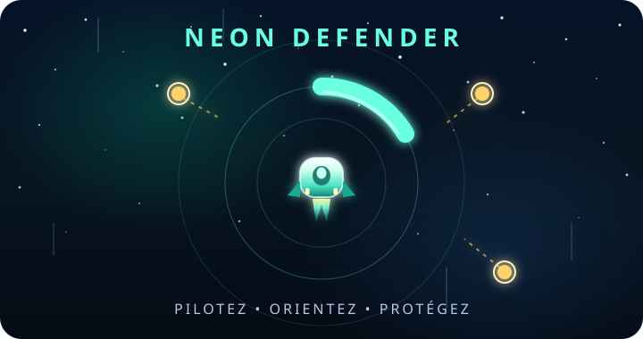
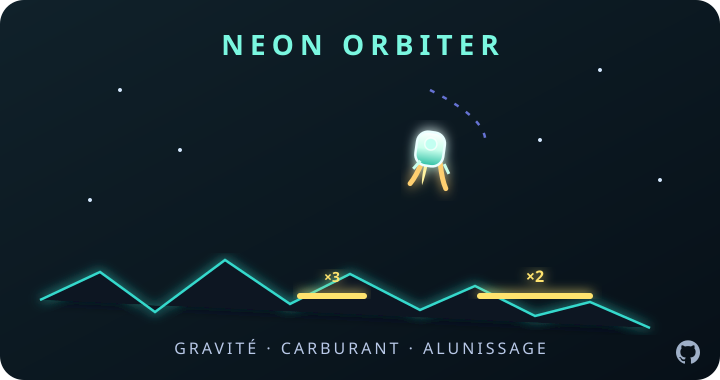
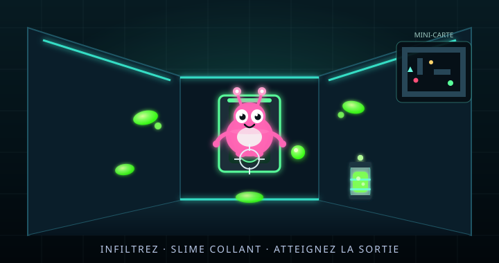
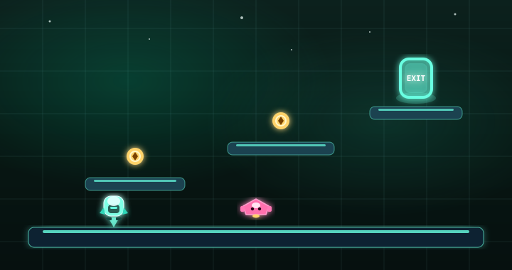
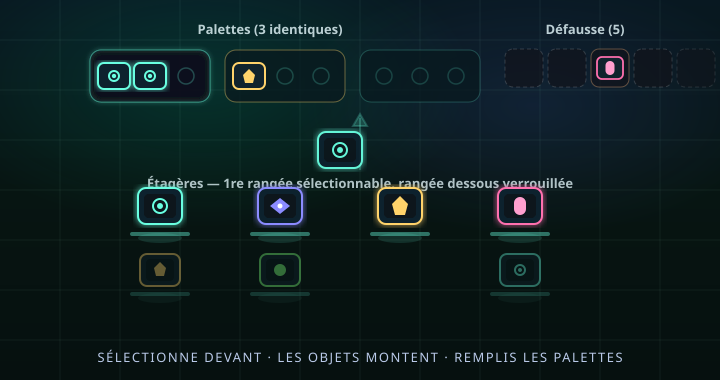

# Arcade Collection

Une collection de quinze mini-jeux indépendants, gratuits et jouables directement dans le navigateur.

## Ouvrir Arcade Collection

[Ouvrir Arcade Collection](https://kewinmarchand.github.io/arcade-collection/)

## Les jeux

### Invaders

[Ouvrir le jeu](https://kewinmarchand.github.io/arcade-collection/apps/invaders/) · [Code source](https://github.com/kewinMarchand/arcade-collection/tree/main/apps/invaders) — Défendez votre base contre des vagues d'envahisseurs.

### Breaker

[Ouvrir le jeu](https://kewinmarchand.github.io/arcade-collection/apps/breaker/) · [Code source](https://github.com/kewinMarchand/arcade-collection/tree/main/apps/breaker) — Cassez les briques et gardez la balle en jeu.

### Columns

[Ouvrir le jeu](https://kewinmarchand.github.io/arcade-collection/apps/columns/) · [Code source](https://github.com/kewinMarchand/arcade-collection/tree/main/apps/columns) — Alignez des gemmes pour déclencher des réactions en chaîne.

### Drift

[Ouvrir le jeu](https://kewinmarchand.github.io/arcade-collection/apps/drift/) · [Code source](https://github.com/kewinMarchand/arcade-collection/tree/main/apps/drift) — Pilotez une voiture sur le circuit, évitez les obstacles et récoltez les orbes.

### Runner

[Ouvrir le jeu](https://kewinmarchand.github.io/arcade-collection/apps/runner/) · [Code source](https://github.com/kewinMarchand/arcade-collection/tree/main/apps/runner) — Sautez et glissez pour éviter les obstacles.

### Defender

[Ouvrir le jeu](https://kewinmarchand.github.io/arcade-collection/apps/defender/) · [Code source](https://github.com/kewinMarchand/arcade-collection/tree/main/apps/defender) — Orientez le bouclier pour intercepter les photons.

### Black Holes

[Ouvrir le jeu](https://kewinmarchand.github.io/arcade-collection/apps/mines/) · [Code source](https://github.com/kewinMarchand/arcade-collection/tree/main/apps/mines) — Explorez les secteurs spatiaux et repérez les trous noirs grâce aux satellites.

### Snake

[Ouvrir le jeu](https://kewinmarchand.github.io/arcade-collection/apps/snake/) · [Code source](https://github.com/kewinMarchand/arcade-collection/tree/main/apps/snake) — Grandissez sans vous mordre, la vitesse s'emballe.

### Orbiter

[Ouvrir le jeu](https://kewinmarchand.github.io/arcade-collection/apps/orbiter/) · [Code source](https://github.com/kewinMarchand/arcade-collection/tree/main/apps/orbiter) — Alunissez en douceur : gravité, carburant et plateformes bonus.

### Maze

[Ouvrir le jeu](https://kewinmarchand.github.io/arcade-collection/apps/maze/) · [Code source](https://github.com/kewinMarchand/arcade-collection/tree/main/apps/maze) — Mangez les pastilles, échappez aux fantômes, passez au niveau suivant.

### Pong

[Ouvrir le jeu](https://kewinmarchand.github.io/arcade-collection/apps/pong/) · [Code source](https://github.com/kewinMarchand/arcade-collection/tree/main/apps/pong) — Renvoyez la balle, marquez des points, premier à 11.

### Strike

[Ouvrir le jeu](https://kewinmarchand.github.io/arcade-collection/apps/strike/) · [Code source](https://github.com/kewinMarchand/arcade-collection/tree/main/apps/strike) — Abattez les vaisseaux avant qu'ils ne vous atteignent.

### Breach

[Ouvrir le jeu](https://kewinmarchand.github.io/arcade-collection/apps/breach/) · [Code source](https://github.com/kewinMarchand/arcade-collection/tree/main/apps/breach) — FPS néon en vue subjective : infiltrez le secteur et éliminez les drones aliens.

### Jumper

[Ouvrir le jeu](https://kewinmarchand.github.io/arcade-collection/apps/jumper/) · [Code source](https://github.com/kewinMarchand/arcade-collection/tree/main/apps/jumper) — Plateformer néon : sautez de plateforme en plateforme et atteignez le portail.

### Sorter

[Ouvrir le jeu](https://kewinmarchand.github.io/arcade-collection/apps/sorter/) · [Code source](https://github.com/kewinMarchand/arcade-collection/tree/main/apps/sorter) — Triez les modules identiques et expédiez les conteneurs avant saturation.

## Thème

Ce dépôt utilise le thème Arcade partagé (`packages/theme-arcade`) et le cadre de jeu commun (`packages/ui`).
