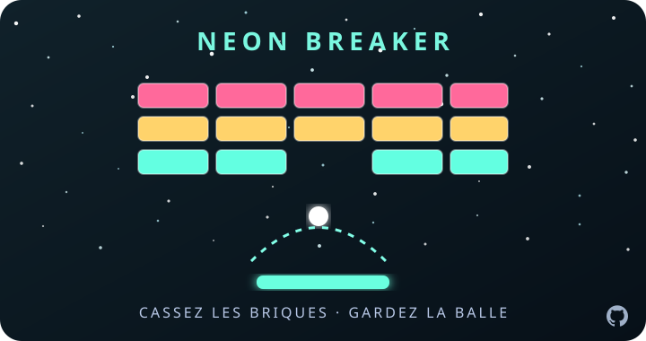

# Neon Breaker

Jeu d'arcade de casse-briques : détruisez les briques et gardez la balle en jeu.

## Jouer en ligne

[Ouvrir Neon Breaker](https://kewinmarchand.github.io/neon-breaker/)

## Commandes

- **← / →** ou **A / D** : déplacer la raquette
- **Espace** ou clic sur le jeu : lancer la balle
- **P** ou le bouton **Pause** : mettre en pause ou reprendre
- **Recommencer** : relancer la partie
- **Nouvelle partie** : recommencer depuis le début
- **Souris ou tactile** : guider la raquette

Cassez les briques pour marquer des points et passer les niveaux.

[Retour à la collection Neon Games](https://kewinmarchand.github.io/neon-games/)

## Thème

Thème **Boilerplate Neon** partagé (`neon/neon-tokens.css`, `neon-base.css`, `neon-components.css`) avec styles propres au jeu (`style.css`).

Le jeu est publié avec GitHub Pages.
