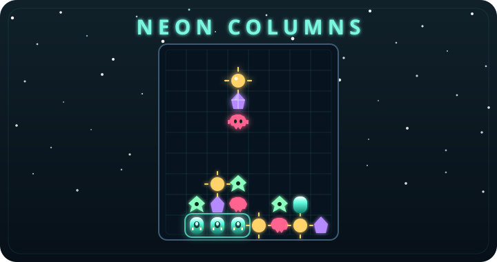

# Columns

Jeu de puzzle arcade : faites tomber des colonnes de gemmes et alignez les couleurs.

## Jouer en ligne

[Ouvrir Columns](https://kewinmarchand.github.io/arcade-columns/)

## Commandes

- **← / →** : déplacer la colonne
- **↓** : accélérer sa descente
- **↑** ou **X** : pivoter les gemmes
- **Espace** : chute rapide
- **P** ou le bouton **Pause** : mettre en pause ou reprendre
- **Nouvelle partie** : recommencer depuis le début

Alignez au moins trois gemmes de même couleur horizontalement, verticalement ou en diagonale. Les gemmes restantes tombent et peuvent créer des réactions en chaîne.

[Retour à la collection Arcade Collection](https://kewinmarchand.github.io/arcade-collection/)

## Thème

Thème **Boilerplate Arcade** partagé (`Arcade/arcade-tokens.css`, `arcade-base.css`, `arcade-components.css`) avec styles propres au jeu (`style.css`).

Le jeu est publié avec GitHub Pages.
