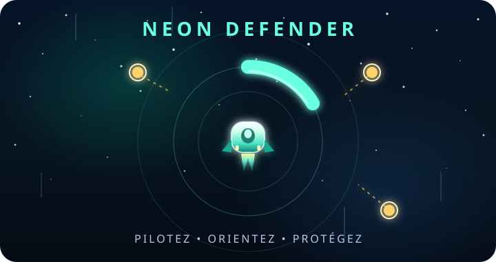

# Neon Defender

Jeu d'arcade de défense : orientez le bouclier pour intercepter les photons et protéger le noyau.

## Jouer en ligne

[Ouvrir Neon Defender](https://kewinmarchand.github.io/neon-defender/)

## Commandes

- **A / D** ou **← / →** : orienter le bouclier
- **Souris ou tactile** : viser en déplaçant le pointeur sur l'arène
- **Espace** : démarrer
- **P** ou le bouton **Pause** : mettre en pause ou reprendre
- **Recommencer** : relancer la partie
- **Nouvelle partie** : recommencer depuis le début

Le meilleur score est conservé dans le navigateur.

[Retour à la collection Neon Games](https://kewinmarchand.github.io/neon-games/)

## Thème

Thème **Boilerplate Neon** partagé (`neon/neon-tokens.css`, `neon-base.css`, `neon-components.css`) avec styles propres au jeu (`style.css`).

Le jeu est publié avec GitHub Pages. Les tests se lancent avec `npm test` (Node.js 18+).
