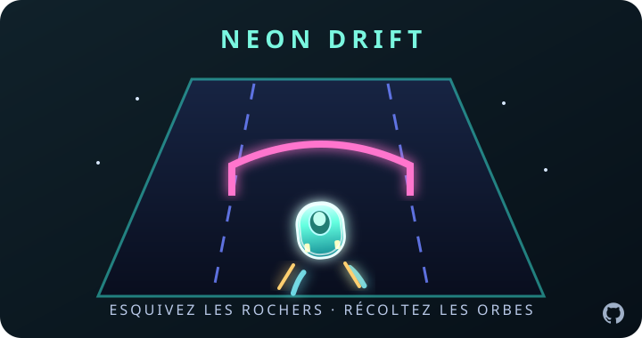

# Drift

Jeu d'arcade de pilotage : dirigez votre voiture sur la piste, évitez les obstacles et récoltez les orbes.

## Jouer en ligne

[Ouvrir Drift](https://kewinmarchand.github.io/arcade-drift/)

## Commandes

- **A / D** ou **← / →** : piloter sur la piste
- **Souris ou tactile** : guider la voiture
- **Espace** : démarrer
- **P** ou le bouton **Pause** : mettre en pause ou reprendre
- **Recommencer** : relancer la course
- **Nouvelle partie** : recommencer depuis le début

Le meilleur score est conservé dans le navigateur.

[Retour à la collection Arcade Collection](https://kewinmarchand.github.io/arcade-collection/)

## Thème

Thème **Boilerplate Arcade** partagé (`Arcade/arcade-tokens.css`, `arcade-base.css`, `arcade-components.css`) avec styles propres au jeu (`style.css`).

Le jeu est publié avec GitHub Pages. Les tests se lancent avec `npm test` (Node.js 18+).
