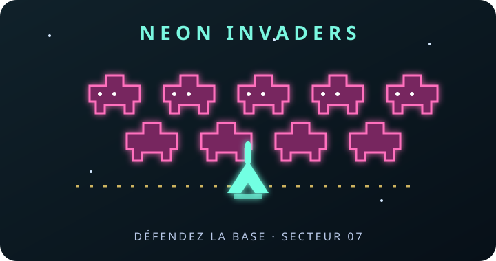

# Invaders

Jeu d'arcade spatial : défendez votre base contre des vagues d'envahisseurs.

## Jouer en ligne

[Ouvrir Invaders](https://kewinmarchand.github.io/arcade-invaders/)

## Commandes

- **A / D** ou **← / →** : déplacer le vaisseau
- **Espace** : tirer ou démarrer
- **P** ou le bouton **Pause** : mettre en pause ou reprendre
- **Recommencer** : relancer la partie
- **Nouvelle partie** : recommencer depuis le début

Éliminez les envahisseurs avant qu'ils n'atteignent la base.

[Retour à la collection Arcade Collection](https://kewinmarchand.github.io/arcade-collection/)

## Thème

Thème **Boilerplate Arcade** partagé (`Arcade/arcade-tokens.css`, `arcade-base.css`, `arcade-components.css`) avec styles propres au jeu (`style.css`).

Le jeu est publié avec GitHub Pages.
