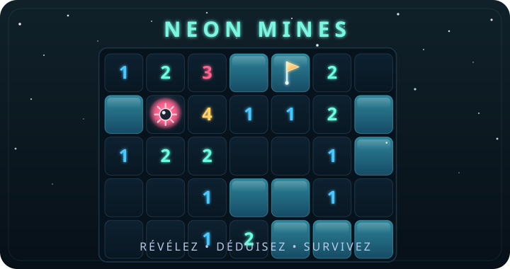

# Neon Mines

Jeu de puzzle logique : déduisez l'emplacement des mines grâce aux indices et révélez les cases sûres.

## Jouer en ligne

[Ouvrir Neon Mines](https://kewinmarchand.github.io/neon-mines/)

## Commandes

- **Clic** : révéler une case
- **Clic droit** : poser ou retirer un drapeau
- **P** ou le bouton **Pause** : mettre en pause ou reprendre
- **Recommencer** : relancer la partie
- **Nouvelle partie** : recommencer depuis le début

La première case révélée est toujours sûre. Le meilleur temps est conservé dans le navigateur.

[Retour à la collection Neon Games](https://kewinmarchand.github.io/neon-games/)

## Thème

Thème **Boilerplate Neon** partagé (`neon/neon-tokens.css`, `neon-base.css`, `neon-components.css`) avec styles propres au jeu (`style.css`).

Le jeu est publié avec GitHub Pages. Les tests se lancent avec `npm test` (Node.js 18+).
