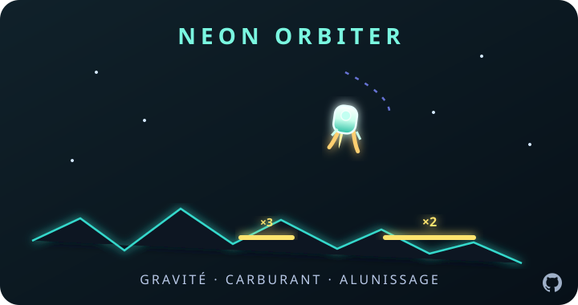

# Neon Orbiter

Lander de lune version néon : gravité, carburant limité et plates-formes d'alunissage bonus ×2 / ×3 / ×4. Chaque manche rend la gravité plus musclée.

## Jouer en ligne

[Ouvrir Neon Orbiter](https://kewinmarchand.github.io/neon-orbiter/)

## Commandes

- **Espace**, **↑** ou **Z** : poussée principale
- **← / →** ou **Q / D** : incliner et dériver
- **P** ou le bouton **Pause** : mettre en pause ou reprendre
- **Clic sur l'arène** : relancer après un écrasement

Un alunissage réussi demande une vitesse verticale et latérale faible et un module bien droit. Le meilleur score est conservé dans le navigateur.

[Retour à la collection Neon Games](https://kewinmarchand.github.io/neon-games/)

## Thème

Thème **Boilerplate Neon** partagé (`neon/neon-tokens.css`, `neon-base.css`, `neon-components.css`) avec styles propres au jeu (`style.css`).

Le jeu est publié avec GitHub Pages. Les tests se lancent avec `npm test` (Node.js 18+).
