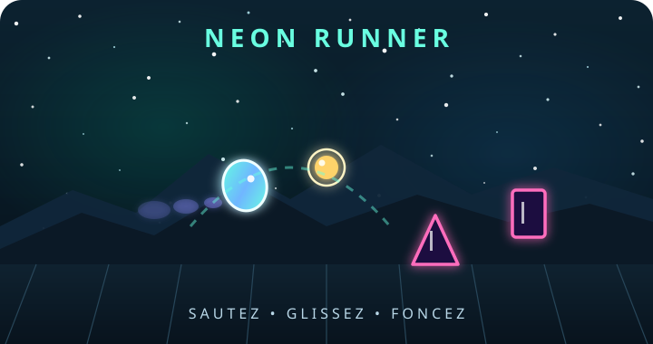

# Runner

Jeu de course arcade : sautez et glissez pour éviter les obstacles et tenir la distance.

## Jouer en ligne

[Ouvrir Runner](https://kewinmarchand.github.io/arcade-runner/)

## Commandes

- **Espace**, **↑** ou **W** : sauter
- **↓** ou **S** : glisser (maintenez pour rester baissé)
- **P** ou le bouton **Pause** : mettre en pause ou reprendre
- **Recommencer** : relancer la course
- **Nouvelle partie** : recommencer depuis le début
- **Clic ou toucher l'arène** : sauter, ou relancer après une défaite

Le meilleur score est conservé dans le navigateur.

[Retour à la collection Arcade Collection](https://kewinmarchand.github.io/arcade-collection/)

## Thème

Thème **Boilerplate Arcade** partagé (`Arcade/arcade-tokens.css`, `arcade-base.css`, `arcade-components.css`) avec styles propres au jeu (`style.css`).

Le jeu est publié avec GitHub Pages. Les tests se lancent avec `npm test` (Node.js 18+).
