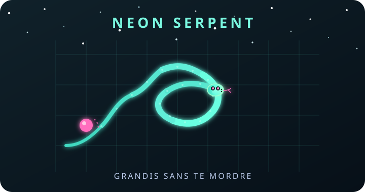

# Neon Serpent

Le classique du serpent, version néon : grandissez sans vous mordre, la vitesse s'emballe.

## Jouer en ligne

[Ouvrir Neon Serpent](https://kewinmarchand.github.io/neon-serpent/)

## Commandes

- **Flèches** ou **ZQSD / WASD** : diriger le serpent
- **Espace** : démarrer
- **P** ou le bouton **Pause** : mettre en pause ou reprendre
- **Clic sur le plateau** : relancer après une défaite

Chaque orbe attrapée allonge le serpent et accélère le rythme. Le meilleur score est conservé dans le navigateur.

[Retour à la collection Neon Games](https://kewinmarchand.github.io/neon-games/)

## Thème

Thème **Boilerplate Neon** partagé (`neon/neon-tokens.css`, `neon-base.css`, `neon-components.css`) avec styles propres au jeu (`style.css`).

Le jeu est publié avec GitHub Pages. Les tests se lancent avec `npm test` (Node.js 18+).
