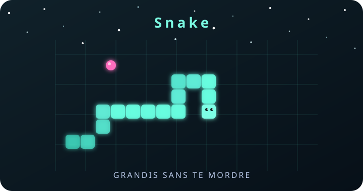

# Snake

Le classique du serpent : grandissez sans vous mordre, la vitesse s'emballe.

## Jouer

[Ouvrir Snake](https://kewinmarchand.github.io/arcade-collection/apps/snake/)

## Commandes

- **Flèches** ou **ZQSD / WASD** : diriger le serpent
- **Espace** / **P** : pause

## Objectif

Chaque orbe attrapée allonge le serpent et accélère le rythme. Le meilleur score est conservé dans le navigateur.

[Retour à la collection](https://kewinmarchand.github.io/arcade-collection/)
